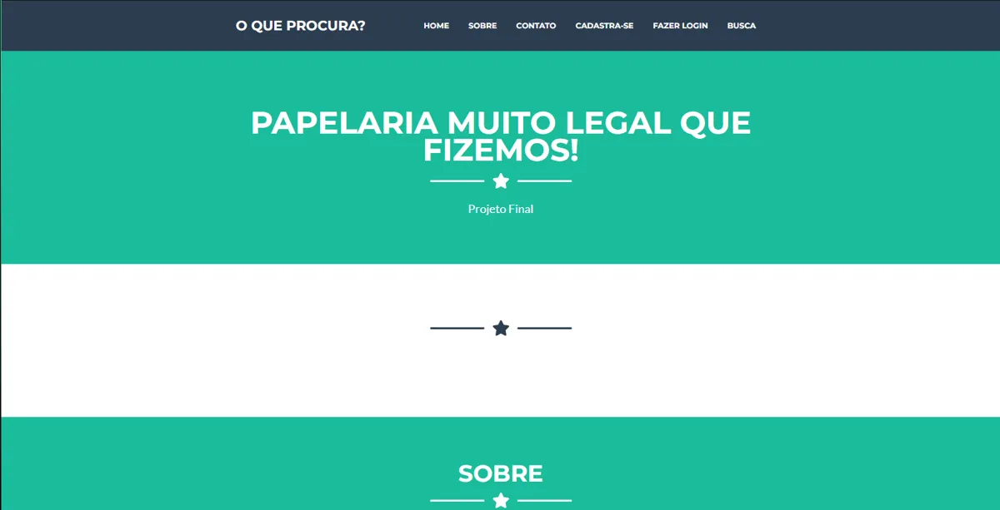

# Papelaria Online — Sistema web

Loja virtual de papelaria feita em grupo como **projeto final do curso técnico**. Tem cadastro e login de clientes, busca de produtos e cadastro de produtos, tudo ligado a um banco de dados MySQL.



## O que tem no projeto

- **Cadastro e login** de clientes (com verificação de login)
- **Busca de produtos**
- **Cadastro de produtos** no banco de dados
- Organização em camadas: Model (beans e DAO), Service, View e Connection
- Telas de administração em Java Swing (JTable)

## Tecnologias

Java · JSP · JPA (EclipseLink) · MySQL · HTML · CSS · Apache Tomcat · NetBeans

## Estrutura

```
src/java/Model/      → beans (Cliente, Produto) e DAOs
src/java/Service/    → regras de cadastro e busca
src/java/View/       → telas em Java Swing
src/java/Connection/ → conexão com o banco
web/                 → páginas JSP, HTML e CSS
```

## Como rodar

1. Abra o projeto no **NetBeans** (ele já tem a pasta `nbproject`).
2. Crie no **MySQL** o banco `dbpapelaria` e ajuste usuário e senha em `src/java/Connection`.
3. Rode no **Apache Tomcat** pelo próprio NetBeans.

> Este projeto precisa de servidor e banco de dados, por isso não tem versão publicada no GitHub Pages.

---
Feito por **Vinicius Lima** · [Portfólio](https://viniciuslimadev.netlify.app) · [LinkedIn](https://www.linkedin.com/in/viniciuslima25/)
